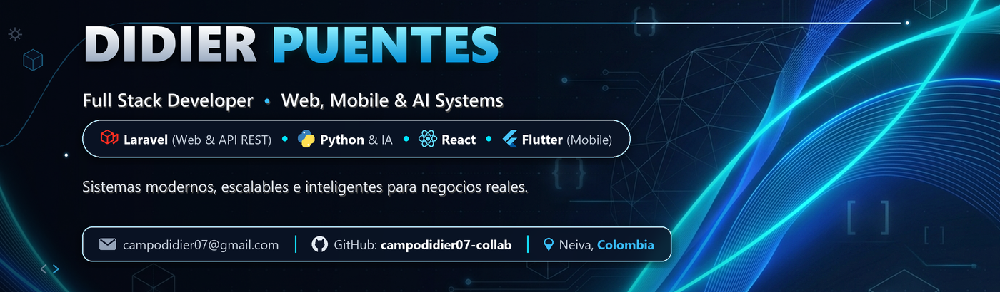
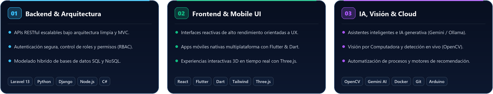
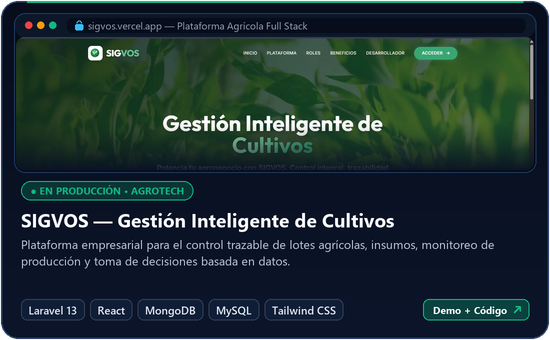
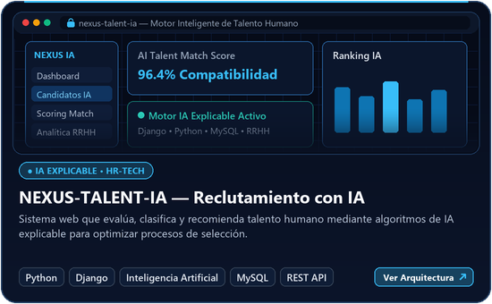
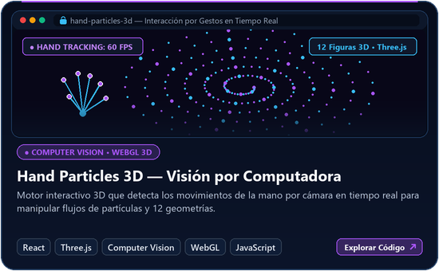
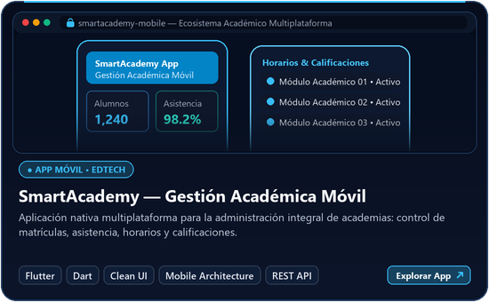
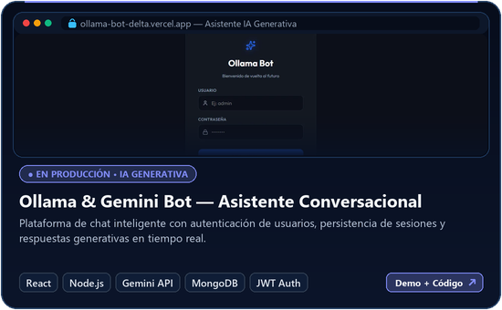
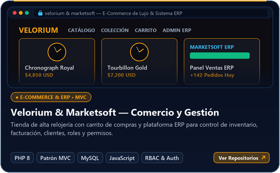
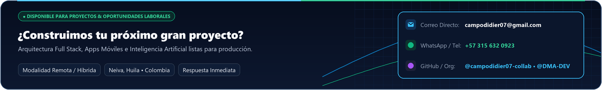

  

  

  
  
  
  
  

---

## 🚀 Perfil Profesional & Arquitectura de Ingeniería

Soy **Didier Puentes** (`@campodidier07-collab`), **Tecnólogo en ADSO y Desarrollador Full Stack** especializado en diseñar y construir **plataformas web escalables, aplicaciones móviles multiplataforma y sistemas inteligentes con IA**.

Mi enfoque combina **arquitectura limpia en el backend** (APIs RESTful, patrón MVC, autenticación segura, roles y permisos) con **interfaces modernas orientadas a la experiencia de usuario** en el frontend, integrando tecnologías avanzadas como **Inteligencia Artificial Generativa, Visión por Computadora (`OpenCV`) y gráficos 3D en tiempo real (`Three.js`)**.

  

  

---

## 💻 Portafolio de Proyectos Destacados

> Haz clic sobre cualquier tarjeta para explorar la arquitectura y el código fuente del proyecto, o utiliza los accesos directos para probar las demos en producción.

  
  

  
  
  
  &nbsp;&nbsp;&nbsp;•&nbsp;&nbsp;&nbsp;
  

 

  
  

  
  &nbsp;&nbsp;&nbsp;•&nbsp;&nbsp;&nbsp;
  

 

  
  

  
  
  &nbsp;&nbsp;&nbsp;•&nbsp;&nbsp;&nbsp;
  
  

---

## ⚙️ Métricas de Ingeniería & Actividad en GitHub

  
  

  
  

  <picture>
    <source media="(prefers-color-scheme: dark)" srcset="https://raw.githubusercontent.com/campodidier07-collab/campodidier07-collab/output/github-contribution-grid-snake-dark.svg" />
    <source media="(prefers-color-scheme: light)" srcset="https://raw.githubusercontent.com/campodidier07-collab/campodidier07-collab/output/github-contribution-grid-snake.svg" />
    
  </picture>

---

  

  
  &nbsp;•&nbsp;
  <i>Arquitectura, diseño y desarrollo por <b>Didier Puentes</b> • Neiva, Colombia 🇨🇴</i>

